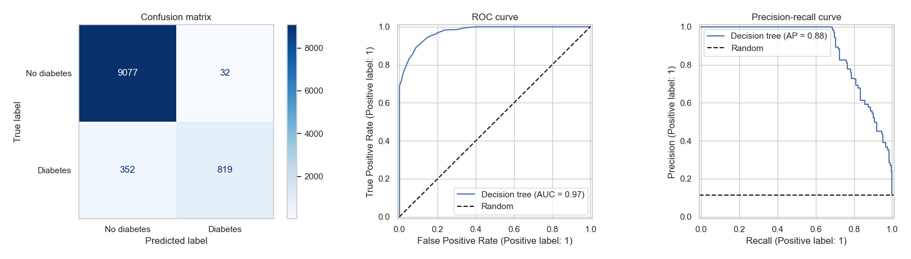
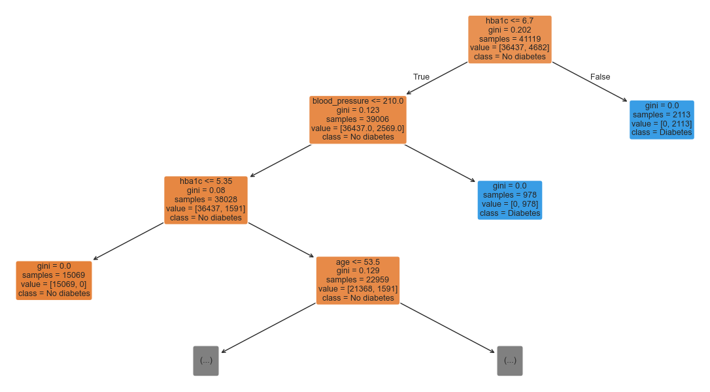

# Diabetes Prediction with Decision Trees

An interpretable classifier that predicts whether a patient has diabetes from a handful of clinical and lifestyle variables. The project goes from data quality checks and exploratory analysis to a cross-validated, tuned decision tree, evaluated with metrics suited to imbalanced data.

## Highlights

- **51,399 patient records** after removing 2,231 duplicates; only about **11.4 %** of them are diabetic, so accuracy alone is misleading (a model that always answers "no diabetes" already scores 88.6 %).
- The tuned tree reaches **96.3 % test accuracy**, a **ROC-AUC of 0.97**, a **PR-AUC of 0.88** and an **F1-score of 0.81** on the diabetic class.
- **Overfitting diagnosed and corrected**: an unconstrained tree scores 99.9 % on the training set but 93.7 % on the test set; after feature selection and tuning the gap disappears (96.2 % vs 96.3 %).
- **Fully interpretable**: four variables, and the first three levels already isolate large, perfectly pure groups of patients.

## Results

All models are evaluated on the same stratified hold-out test set (10,280 patients). Precision, recall and F1 refer to the diabetic class.

| Model | Train accuracy | Test accuracy | Precision | Recall | F1 |
| --- | ---: | ---: | ---: | ---: | ---: |
| Dummy (majority class) | 0.8861 | 0.8861 | 0.0000 | 0.0000 | 0.0000 |
| Tree, all features, no tuning | 0.9986 | 0.9373 | 0.7097 | 0.7600 | 0.7340 |
| Tree, selected features, no tuning | 0.9924 | 0.9391 | 0.7250 | 0.7498 | 0.7372 |
| **Tree, selected features, tuned** | **0.9623** | **0.9626** | **0.9624** | **0.6994** | **0.8101** |

Best configuration found by the grid search (cross-validated F1 = 0.798): `criterion="gini"`, `max_depth=10`, `min_samples_leaf=20`, `min_samples_split=50`, `class_weight=None`.



On the 10,280 test patients, the confusion matrix counts 9,077 true negatives, 819 true positives, 352 false negatives and only 32 false positives.

### Reading the tree

The first three levels of the tuned tree (training-set counts):



The root tests `hba1c` and sends every patient above 6.7 (2,113 patients, all diabetic) to a pure leaf. Below that threshold, a `blood_pressure` value above 210 isolates a second pure group of 978 diabetic patients, then `hba1c <= 5.35` discards 15,069 non-diabetic patients. Only the intermediate cases need finer rules, starting with `age`.

## Dataset

`diabete_arbre.csv`: 53,630 rows, 9 columns, semicolon-separated, no missing values. Column names are in French in the file; the notebook renames them to English.

| Column in the file | Name in the notebook | Type | Description |
| --- | --- | --- | --- |
| `sexe` | `sex` | categorical | `F` / `M` (encoded as `is_male`) |
| `hypertension` | `hypertension` | binary | 0 / 1 |
| `maladie_cardiaque` | `heart_disease` | binary | 0 / 1 |
| `fumeur` | `smoking_status` | categorical | `non` / `ancien` / `oui` (never / former / current) |
| `pression_sang` | `blood_pressure` | numeric | values from 80 to 300 |
| `diabete` | `diabetes` | binary | **target**, 0 / 1 |
| `age` | `age` | numeric | years, 0.16 to 80 |
| `imc` | `bmi` | numeric | body mass index |
| `hba1c` | `hba1c` | numeric | HbA1c level, 3.5 to 9.0 |

The dataset was provided as course material. Its origin and collection protocol are not documented, and the unit and exact meaning of `pression_sang` are not specified in the file. It contains no direct identifier (no name, date or location).

## Methodology

1. **Data quality**: no missing values; 2,231 exact duplicates (4.2 %) removed before splitting, so that identical rows cannot leak from the training set to the test set.
2. **Exploratory analysis**: target distribution, distributions and outliers (1.5 x IQR rule; tree-based models are insensitive to outliers and monotonic transformations, so no scaling or outlier removal is needed), diabetes rate by category and correlations.
3. **Preprocessing**: `sex` encoded as a binary variable, `smoking_status` one-hot encoded (reference level: never), stratified 80/20 split (41,119 training / 10,280 test patients).
4. **Baselines**: a majority-class dummy classifier and an unconstrained tree (depth 30, 2,675 leaves) that clearly overfits.
5. **Feature selection**: Gini importance computed on the training set only. `hba1c` and `blood_pressure` carry about 75 % of the total importance; the variables above 0.05 are kept (`hba1c`, `blood_pressure`, `age`, `bmi`).
6. **Hyperparameter tuning**: grid search with 5-fold stratified cross-validation (324 candidates, 1,620 fits) over the criterion, `max_depth`, `min_samples_split`, `min_samples_leaf` and `class_weight`, ranked on the F1-score of the positive class rather than on accuracy.
7. **Final evaluation** on the held-out test set: classification report, confusion matrix, ROC and precision-recall curves.
8. **Interpretation** of the tuned tree (first levels exported as a plot and as text rules).

## Repository structure

```
.
├── diabetes_decision_tree.ipynb   # Full analysis, outputs included
├── diabete_arbre.csv              # Dataset
├── requirements.txt               # Python dependencies
└── images/                        # Figures used in this README
```

The notebook is saved with its outputs, so it can be read directly on GitHub without running anything.

## Getting started

Python 3.10 or later is recommended.

```bash
git clone https://github.com/jeremiendjoye/diabetes-decision-tree.git
cd diabetes-decision-tree

python -m venv .venv
source .venv/bin/activate        # Windows: .venv\Scripts\activate
pip install -r requirements.txt

jupyter notebook diabetes_decision_tree.ipynb
```

Run all cells from top to bottom. The notebook loads `diabete_arbre.csv` from its own folder and fixes the random seed (`RANDOM_STATE = 51016`) so that results are reproducible. The grid search fits 1,620 models and uses all available CPU cores; the whole notebook runs in about a minute on a recent laptop.

The analysis was developed with Python 3.12. It was also re-run from scratch in a fresh environment with Python 3.13, NumPy 2.5, pandas 3.0 and scikit-learn 1.9: every reported metric is identical.

## Limitations and next steps

- **Recall on diabetic patients (about 70 %) is the main weakness**: roughly three diabetic patients out of ten are missed. In a screening context, a false negative costs more than a false positive, so the decision threshold (or `class_weight`) should be tuned to favour recall, at the price of some precision.
- The best configurations of the grid search differ by less than the cross-validation standard deviation, so the selected hyperparameters should not be over-interpreted.
- A single train/test split was used; repeated cross-validation would give a more robust estimate of the generalisation error.
- Ensemble methods (Random Forest, Gradient Boosting) usually improve on a single tree at the cost of interpretability and are a natural next step.

## Disclaimer

This is an educational project. The dataset does not document its origin or collection protocol, and the model must not be used for medical decisions.

## Author

**Jérémie NDJOYE**, data science student (BUT Science des Données) and apprentice assistant engineer at INSERM.

Portfolio: [jeremiendjoye.fr](https://jeremiendjoye.fr) · LinkedIn: [jérémie-ndjoye](https://www.linkedin.com/in/j%C3%A9r%C3%A9mie-ndjoye)
